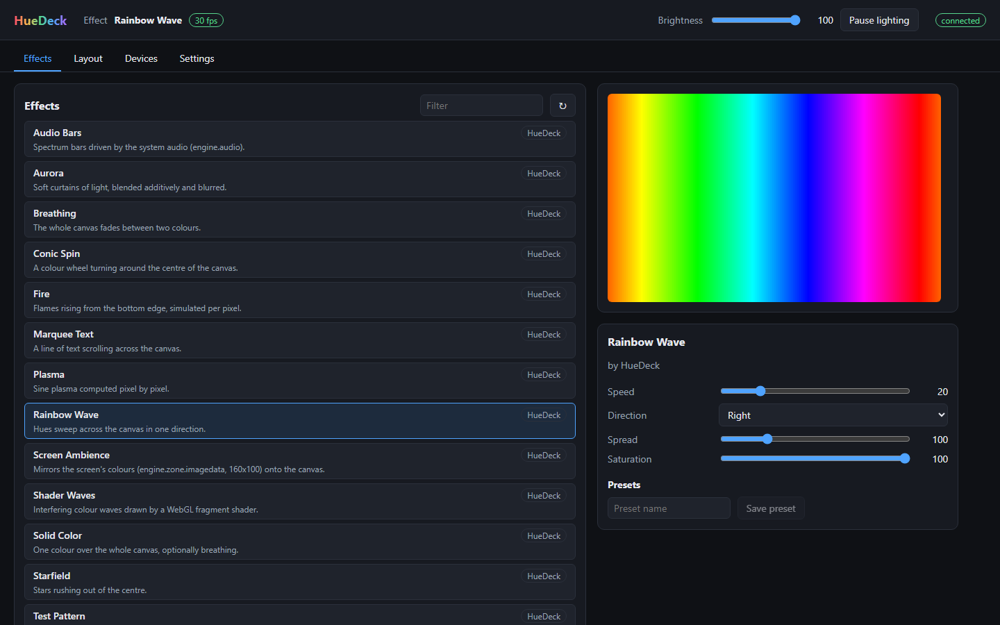

<!-- SPDX-License-Identifier: GPL-3.0-or-later -->
<div align="center">

# Lightloom

### Every light in your setup. One open app. Nothing else to install.

Lightloom is a free, open-source RGB lighting manager. It talks to your motherboard,
mouse, cooler, headset and LED strips directly, plays effects written as web pages,
and gives you a modern dashboard in your browser.

**No account. No telemetry. No ads. No paid tier.**

[](https://github.com/MrMoraleDev/Lightloom/actions/workflows/ci.yml)
[](LICENSE)


[Why Lightloom](#why-lightloom) · [Features](#features) · [Devices](#supported-devices) ·
[Quick start](#quick-start) · [Add your device](#add-your-device) · [Roadmap](#roadmap)

</div>

<p align="center">
  
</p>

> **Pre-alpha.** Lightloom already drives real hardware with its own plugins, renders
> effects and has a working dashboard, but there is no installer yet: today you build
> it from source. Watch the repository to catch the first release.

## Why Lightloom

- **Standalone.** Download Lightloom and control your lights. No vendor suite, no other
  RGB program in the background, no cloud service.
- **Private by design.** No account, no sign-in, no telemetry, no ads, no "Pro"
  subscription. Lightloom never phones home: its daemon listens only on `127.0.0.1`,
  and every change needs a token that only your user account can read.
- **A dashboard you will enjoy using.** Pick an effect and tune it live, save presets,
  watch a live preview of the canvas and drag your devices into place on a visual
  layout. It runs in any browser, served by Lightloom itself.
- **Effects are web pages.** Every effect is an HTML5 canvas page rendered by real
  Chromium, so anything a browser can draw can light up your room. In our tests,
  20 out of 20 effects came out bit-identical to Chrome.
- **Fast and light.** A Rust daemon with one thread per device: colours reach the
  hardware 2 to 4 ms after the effect paints them, 30 times a second.
- **Easy to extend.** One small JavaScript file per device family; supporting a new
  model of a known family is usually one more product id. An effect is one `.html`
  file.
- **Kind to your hardware.** No kernel driver, no admin rights for USB devices,
  `--dry-run` to see every packet before anything is written, devices handed back
  cleanly on exit, and other apps are never killed: Lightloom tells you what to close.
- **Already using SignalRGB?** Lightloom can optionally use your SignalRGB effects,
  plugins and layout too ([details](#signalrgb-compatibility-optional)).
- **Free forever.** GPL-3.0-or-later: nobody can ship a closed Lightloom with ads or
  spyware added. Plugins and effects can use any license.

## Features

### One canvas for the whole setup

- Effects paint a 320×200 canvas; every device takes its colours from where it sits
  on the layout, so an effect flows across your desk from device to device.
- Per-device position, size, rotation and mirroring; global, layout and per-device
  brightness; several layouts to switch between.
- ARGB headers: tell Lightloom what is connected (fans, strips, how many LEDs) and
  every component gets its own place on the canvas.
- Hot-plug: unplug and replug a device, and Lightloom picks it up again.

### Effects

- 13 starter effects included, public domain (CC0): rainbow wave, plasma, aurora,
  fire, starfield, shader waves (WebGL), breathing, conic spin, marquee text, solid
  colour, test pattern, plus audio bars and screen ambience (live audio and screen
  input arrive with M6).
- An effect's `<meta>` tags become dashboard controls (sliders, colour pickers, lists,
  switches) automatically; save your favourite settings as presets.
- Drop your own `.html` file into the effects folder and it shows up in the list.
- Games and tools can send events to the running effect over the local API.

### Dashboard, API and command line

- **Dashboard** at `http://127.0.0.1:16138`: effects with live controls and preview,
  layout editor, devices and channels, settings, export and import of your whole
  setup in one file.
- **Local API**: everything the dashboard does, over REST and WebSocket (`/v1/...`),
  with live state events and a live canvas stream. Script your lights.
- **`lightloom` CLI**: list devices, set a colour, run an effect, record and replay
  device traffic, benchmark latency.

### SignalRGB compatibility (optional)

Lightloom never needs SignalRGB. If you have it installed, one setting lets Lightloom
also:

- run the **device plugins** of your installation, for devices Lightloom's own library
  does not cover yet;
- run your **SignalRGB effects** unchanged;
- use its **components** (fans, strips) to describe your ARGB channels;
- **import your layout and channel setup** with one click;
- answer tools and game integrations written for **SignalRGB's local API**
  (ports 16038 and 16034) while SignalRGB itself is not running.

Those files are read where they are: never copied, changed or redistributed. The
plugin and effect formats are the same, so community plugins and effects in the
SignalRGB format run in Lightloom too.

## Supported devices

Lightloom's own plugin library, tested on real hardware:

| Device | USB id | What lights up |
|---|---|---|
| MSI Mystic Light boards (185-byte protocol), e.g. MAG B550 Tomahawk | `1462:7C91` | six onboard LEDs, both 12 V RGB headers, ARGB strips on both JRAINBOW headers, LED by LED |
| Razer DeathAdder V2 Pro (wired; receiver `007D` untested) | `1532:007C` | logo |
| NZXT Kraken X53 / X63 / X73 | `1E71:2007` | pump ring, logo, RGB header on the pump |
| SteelSeries Arctis 5 | `1038:12AA` | both ear cups |
| Sony DualSense, over USB | `054C:0CE6` | light bar (volume, vibration and the other LEDs are never touched) |

Plus **any HID LampArray device**, the open standard behind Windows Dynamic Lighting
(keyboards, mice and more from many brands): one generic plugin reads the lamps and their
positions from the device itself (tested on the Razer DeathAdder V2 Pro's LampArray
interface).

Coming next: network lights (**WLED, Philips Hue, Govee, Nanoleaf, LIFX, Yeelight**),
then many more families adapted from OpenRGB. Missing your device?
[Add it](#add-your-device) or open an issue with its USB id.

## Quick start

There is no release yet. From source (stable Rust toolchain, Windows for now):

```text
cargo build --release                          # lightloomd and lightloom
cargo build --release -p lightloom-renderer --features cef   # effects (CMake + Ninja on PATH)
cd ui && npm ci && npm run build               # the dashboard (ui/dist)
target/release/lightloomd --open                 # devices, effects, API; opens http://127.0.0.1:16138
```

`lightloomd` finds the renderer, the dashboard, its plugins and starter effects next
to its executable (in a source checkout: the tree's `plugins/`, `effects/` and
`ui/dist`). Settings live in `%LOCALAPPDATA%\Lightloom` (database, API token) and
`%APPDATA%\Lightloom\config.toml` (ports, frame rate, extra plugin directories,
devices to leave alone); `--home DIR` keeps everything in one directory,
`--dry-run` never writes to devices. Close other RGB software that owns the same
devices: Lightloom leaves them alone while it runs and tells you so.

The command-line tool drives devices without the daemon (stop `lightloomd` first):

```text
target/release/lightloom devices                        # read-only: devices, collections, report lengths
target/release/lightloom light red --dry-run            # read the device, print the packets, write nothing
target/release/lightloom light "#00ff00" --restore-check  # hold a colour until Ctrl-C, then restore and verify
target/release/lightloom effect effects/plasma.html --prop speed=60   # render an effect onto every device
target/release/lightloom light red --record t.json      # record every HID operation ...
target/release/lightloom compat replay t.json           # ... and replay it against the plugins, no hardware
target/release/lightloom bench --mock 1462:7c91         # latency percentiles against a scripted device
```

Measurements on the reference machine: [effects](docs/hardware/effects-m3.md),
[daemon and dashboard](docs/hardware/daemon-m4.md).

## Add your device

A device plugin is one JavaScript file per device family. The heart of the Razer
plugin:

```js
export function Name() { return "Razer DeathAdder V2 Pro"; }
export function VendorId() { return 0x1532; }
export function ProductId() { return [0x007C, 0x007D]; }  // a new model: often just one more id
export function Size() { return [1, 1]; }
export function LedNames() { return ["Logo"]; }

export function Render() {                 // 30 times a second
  const [r, g, b] = device.color(0, 0);    // what the effect painted where the mouse sits
  send(0x0F, 0x03, [0, 0, 0, 0, 0, r, g, b]);
}
```

Three ways to learn a device's protocol, all documented in
[plugins/README.md](plugins/README.md):

1. **Record it.** Lightloom records every HID exchange (`--record`); a probe effect
   paints each LED with its own coordinates, and the probe tools in
   [tools/device-probe/](tools/device-probe/) read back which byte drives which LED.
2. **Read the spec.** Public standards (HID LampArray) and vendors' published APIs
   (WLED, Hue, Govee, Nanoleaf, LIFX, Yeelight).
3. **Adapt it from OpenRGB.** Its device code is GPL-2.0-or-later, so it can become
   a Lightloom plugin, with its authors credited in the file.

Every first-party plugin is tested byte for byte against recorded traffic
(`node --test "plugins/**/*.test.mjs"`), and `lightloom bench --mock` runs it in the
real host against a scripted device before it touches hardware.

## How it works

```text
 effect.html ──► Chromium, offscreen (lightloom-renderer) ──► 320×200 canvas, 30 fps
                                                              │ shared memory
                                                              ▼
 dashboard ◄─► local API ◄─► lightloomd (Rust): layout, brightness, SQLite settings
                                │
                                └─► one thread per device: its plugin turns the
                                    sampled colours into packets ──► USB / HID
```

- `lightloomd`: the per-user, unprivileged daemon: device plugins, layout and
  sampling, effects, settings (SQLite), local API and dashboard.
- `lightloom`: the command-line tool.
- `lightloom-renderer`: effects in real Chromium (CEF), in a process of their own; a
  crashed effect is restarted in under 2 seconds, holding the last frame meanwhile.
- `lightloom-iobroker` (planned, M5, opt-in): an optional Windows service for RAM,
  GPU and other SMBus devices through the signed [PawnIO](https://pawnio.eu/)
  driver. Not needed for USB, HID, serial or network devices.

Long form: [docs/architecture.md](docs/architecture.md). Decisions:
[docs/adr/](docs/adr/).

## Roadmap

| Milestone | Scope | Status |
|---|---|---|
| M0 | Workspace, CI, hardware abstraction, decision records, host API spec | done |
| M1 | First light from the command line (MSI Mystic Light) | done |
| M2 | Plugin host, hot-plug, record and replay, conformance suite | done |
| M3 | Effects in Chromium, layouts, sampling, benchmarks | done |
| M4 | Daemon, settings, local API, dashboard, SignalRGB import, installer | in progress: installer next |
| Devices | Lightloom's own plugin library: network lights, OpenRGB families | in progress |
| M5 | RAM, GPU and SMBus devices through PawnIO, sensors | planned |
| M6 | Audio and screen-reactive effects, network lights, LCD screens, macros, OpenRGB SDK server | planned |
| M7 | Linux, AppImage/Flatpak, 1.0 | planned |

## Repository layout

```text
crates/     Rust crates: daemon, CLI, plugin host, renderer, engine, API, hardware layers
ui/         the dashboard (Svelte + TypeScript)
plugins/    Lightloom's device plugins, with recorded fixtures and tests
effects/    starter effects (CC0)
prelude/    JavaScript host modules for plugins (@SignalRGB/* and @lightloom/*)
schemas/    JSON Schemas of manifests, components, layouts and effect metadata
docs/       host API spec, decision records, architecture, hardware notes
tools/      device probe, effects benchmark, udev rule generator
packaging/  systemd and udev files
tests/      schema and conformance tests
```

## Contributing

Device plugins, protocol recordings, effects, bug reports and reviews are all
welcome. Start with [CONTRIBUTING.md](CONTRIBUTING.md) (where code may come from,
DCO sign-off, conventional commits, how to run the tests); security issues go
through [SECURITY.md](SECURITY.md); the project follows the
[Code of Conduct](CODE_OF_CONDUCT.md).

## License

Lightloom is free software under the **GNU General Public License v3.0 or later**
([LICENSE](LICENSE)).

- You may use, study, share, modify and even sell it. Whoever distributes Lightloom,
  modified or not, must pass on its source under the same license, so nobody can
  ship a closed version with ads or telemetry added.
- **Add-ons can use any license.** Device plugins, effects and other add-ons that
  work through Lightloom's plugin, effect, file-format and local-API interfaces are not
  bound by the GPL ([LICENSE-EXCEPTION.md](LICENSE-EXCEPTION.md)).
- The starter effects in `effects/` are CC0-1.0: remix them freely.
- Code adapted from other GPL projects, such as OpenRGB, keeps its authors'
  copyright and names its source in every file.

Details: [ADR-0010](docs/adr/0010-license-gpl-3.md). Contributions are accepted
under the same license with a DCO sign-off.

## Trademarks

SignalRGB is a trademark of Whirlwind Virtual Realities Inc. Lightloom is an
independent project, not affiliated with, endorsed by or sponsored by Whirlwind
Virtual Realities Inc.; the name is used only to describe compatibility. OpenRGB,
PawnIO, Chromium, NVIDIA, AMD and all device vendor names are trademarks of their
respective owners.
